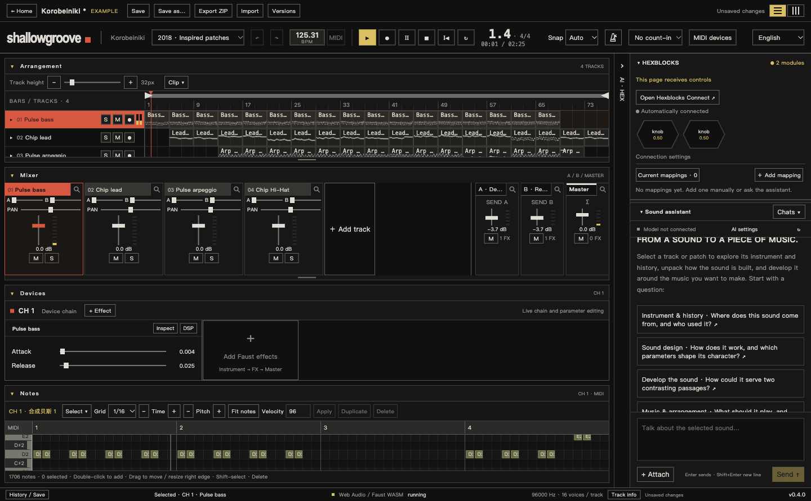
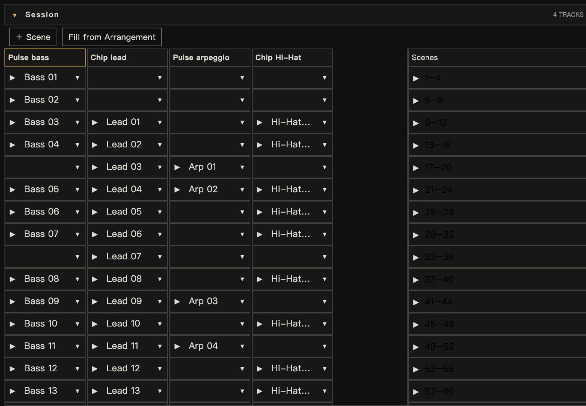
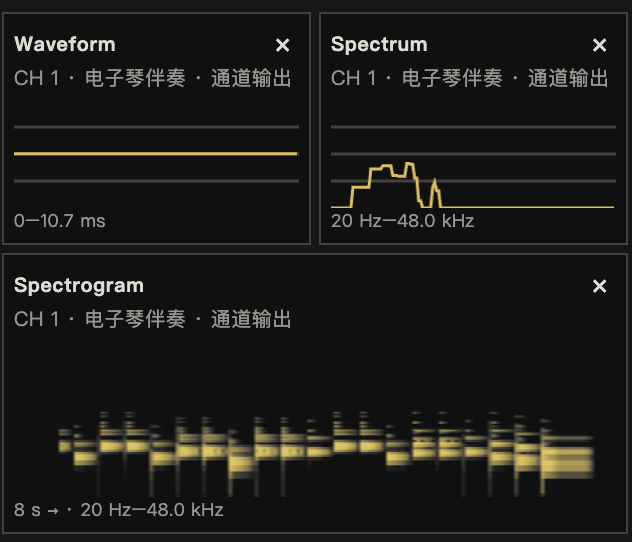
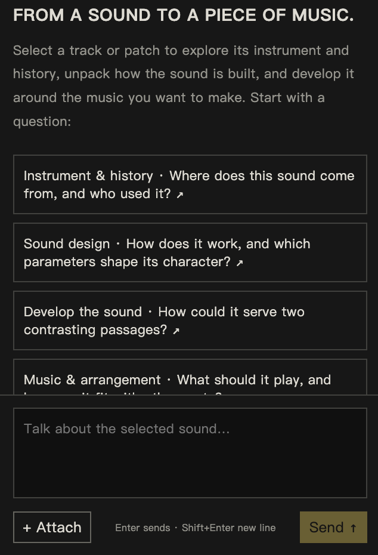
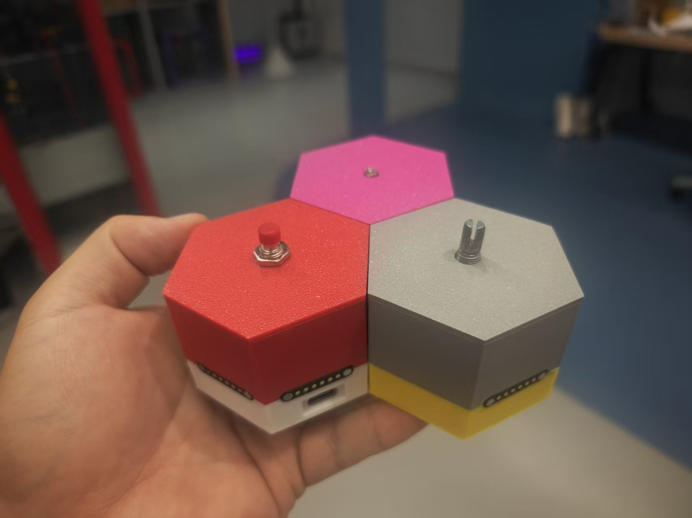
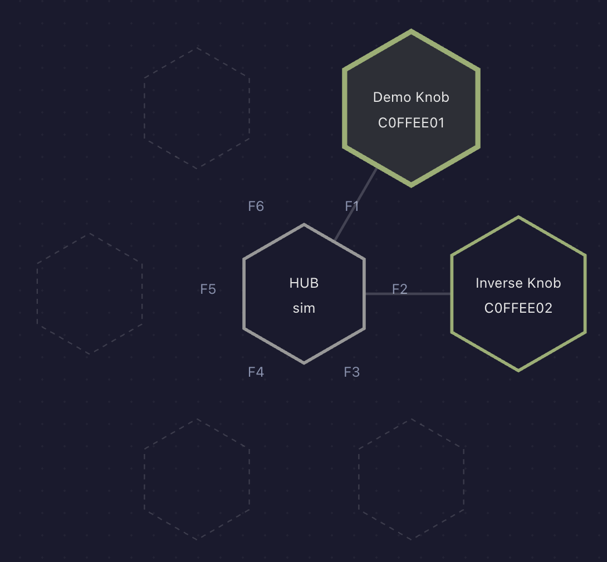

<h1 align="center">ShallowGroove</h1>

<strong>Everything is a Plugin... including a Digital Audio Workstation.</strong>

An LLM-enabled DAW. 
Inspired by the everything-is-a-plugin design of <a href="https://github.com/deepseek-ai/deepseek-harness">DeepSeek Harness</a> (<a href="https://arxiv.org/abs/2608.25512">paper</a>).

<a href="README.zh-CN.md">简体中文</a> · <a href="https://github.com/zmk5566/shallowgroove/releases/latest">Download for macOS or Windows</a>

### Compose and perform

Record MIDI with a metronome and count-in, or draw notes and edit their velocity in the piano roll. In Session view, launch individual clips or a whole scene. Place the same clip at several points in an arrangement and edit the phrase once, or fork a variation for the next section.

### Shape the sound

Faust is a programming language for audio signal processing. ShallowGroove uses it for instruments and effects. Open a device’s DSP panel to edit its source, then hear the change in your mix. Inspect the waveform, spectrum or spectrogram while it plays. [Faust](https://faust.grame.fr/)

The optional DeepSeek assistant can edit notes, arrange clips and help write patches using your own API key.

### Play with HexBlocks

[HexBlocks](https://github.com/zmk5566/Hexblocks) is a set of hexagonal hardware modules that fit together. Connect knobs, buttons or sensors to a Hub to control sound in ShallowGroove.

View the connections in HexBlocks Connect and map a knob to a synth, effect or mixer parameter. Record the movement as automation, then edit the envelope on the track. The topology below shows two simulated knobs you can use to try a mapping.

### Credits

The *Daisy Bell* example pays tribute to Max Mathews, who programmed the accompaniment for the 1961 Bell Labs recording. The *Korobeiniki* example draws on Spino2006’s 2018 SID arrangement. [The Bell Labs recording](https://blogs.loc.gov/now-see-hear/2014/05/singing-circuits/)

Thanks to the Faust team at GRAME and the contributors to its WebAssembly tools. [Faust WebAssembly tools](https://github.com/grame-cncm/faustwasm) · [Credits and licenses](NOTICE.md)
