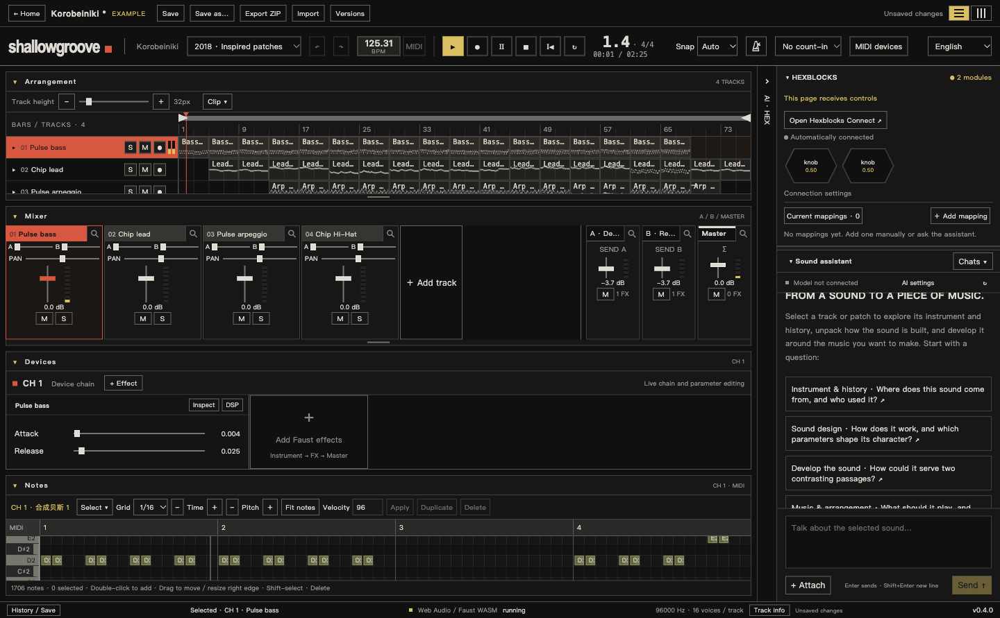
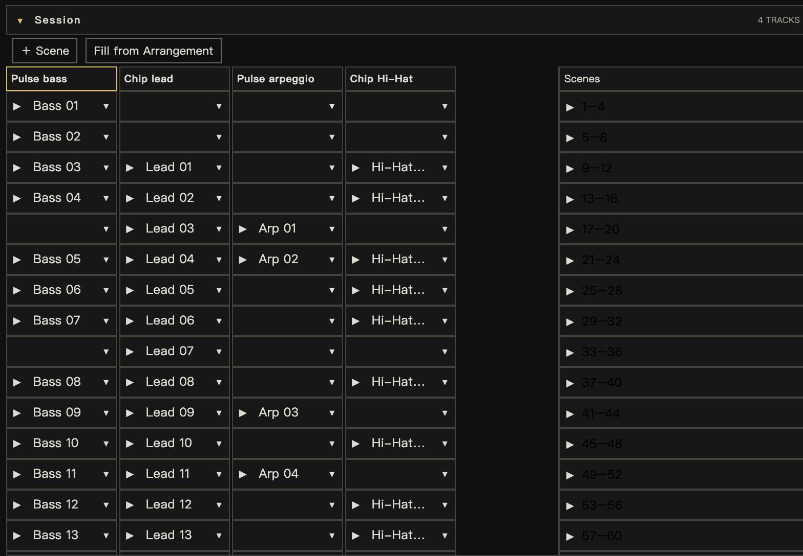
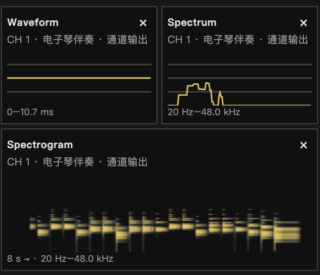
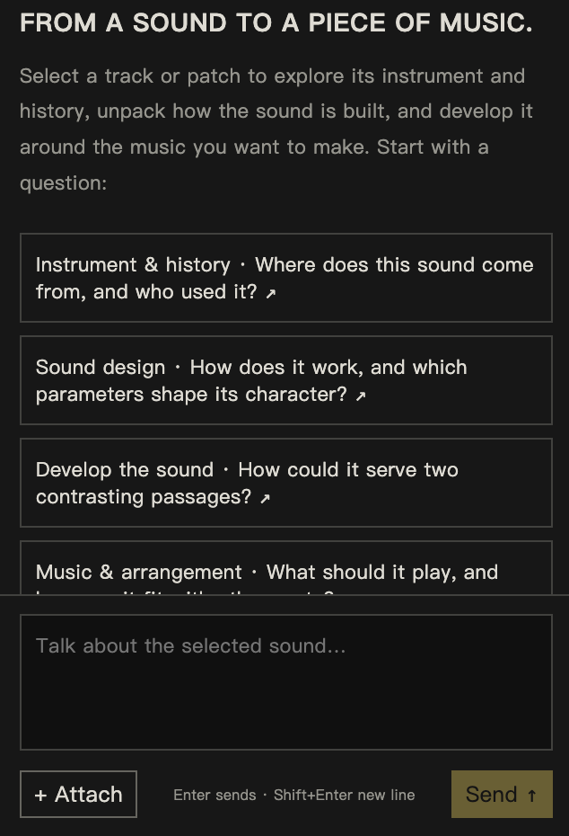
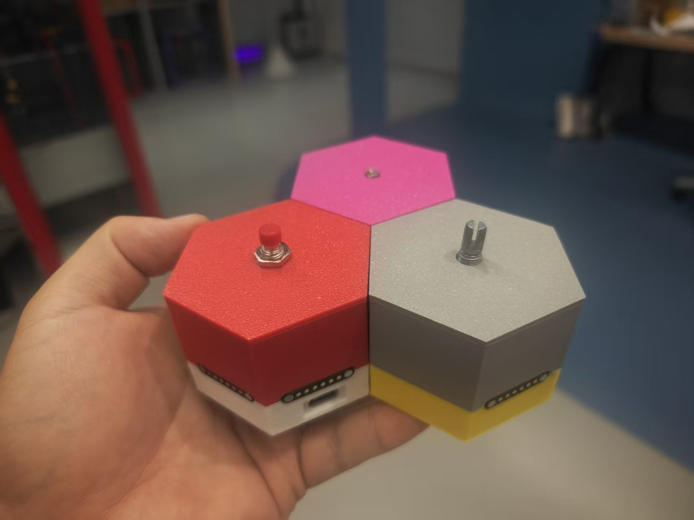
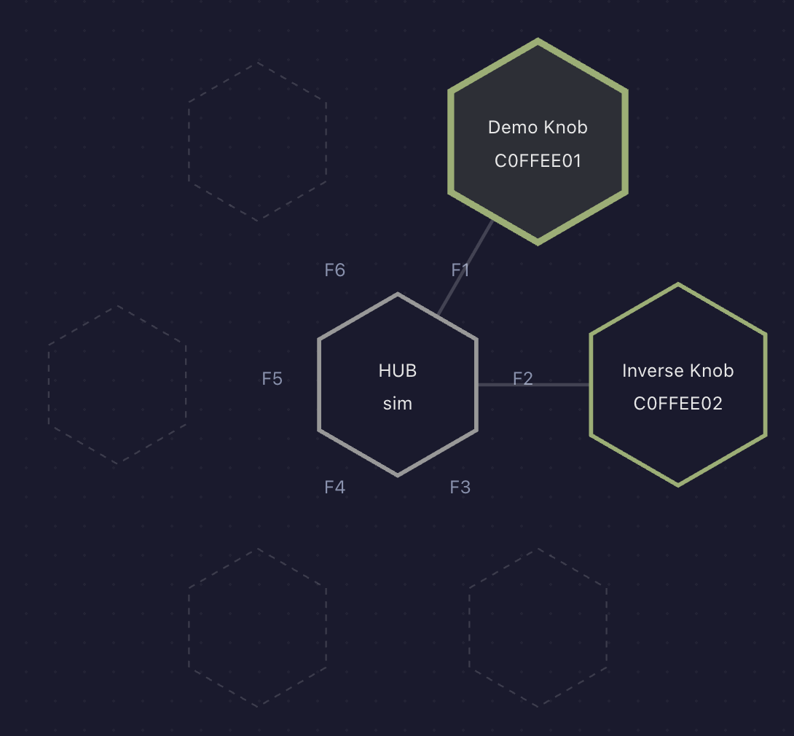

<h1 align="center">ShallowGroove</h1>

<strong>一切皆插件……数字音频工作站也不例外。</strong>

一款支持大语言模型的数字音频工作站。 
灵感来自 <a href="https://github.com/deepseek-ai/deepseek-harness">DeepSeek Harness</a> 的「一切皆插件」设计。〔<a href="https://arxiv.org/abs/2608.25512">论文</a>〕

<a href="README.md">English</a> · <a href="https://github.com/zmk5566/shallowgroove/releases/latest">下载 macOS 或 Windows 版</a>

### 编曲与现场演奏

跟着节拍器和预备拍录 MIDI，也可以直接在钢琴卷帘里画音符、调力度。在现场视图里，可以触发单个 clip，也可以整行触发场景。编曲里重复出现的乐句可以引用同一个 clip，改一次即可同步；需要不同的结尾时，再从它分出一个变体。

### 合成与效果

Faust 是一门用于声音信号处理的编程语言。ShallowGroove 用它编写乐器和效果器。打开设备的 DSP 面板就能编辑源码，在当前混音里试听，再用波形、频谱或声谱图观察变化。[Faust 官网](https://faust.grame.fr/)

填入自己的 DeepSeek API Key 后，还可以让助手编辑音符、排列 clip 或一起写 patch。

### 用 HexBlocks 控制声音

[HexBlocks](https://github.com/zmk5566/Hexblocks) 是一套可以拼接的六边形硬件模块。把旋钮、按钮或传感器接到 Hub，就能在 ShallowGroove 里用它们控制声音。

在 HexBlocks Connect 里查看模块的连接关系，把旋钮映射到合成器、效果器或调音台参数。演奏时可以录下旋钮动作，之后在轨道上编辑自动化包络。下图是用两个模拟旋钮试映射时的拓扑。

### 致谢

《Daisy Bell》示例向 Max Mathews 致敬。1961 年贝尔实验室录制这首歌时，由他编程实现伴奏。《Korobeiniki》示例参考了 Spino2006 在 2018 年制作的 SID 编曲。[贝尔实验室录音](https://blogs.loc.gov/now-see-hear/2014/05/singing-circuits/)

感谢 GRAME 的 Faust 团队及其 WebAssembly 工具的贡献者。[Faust WebAssembly 工具](https://github.com/grame-cncm/faustwasm) · [署名与许可](NOTICE.md)
